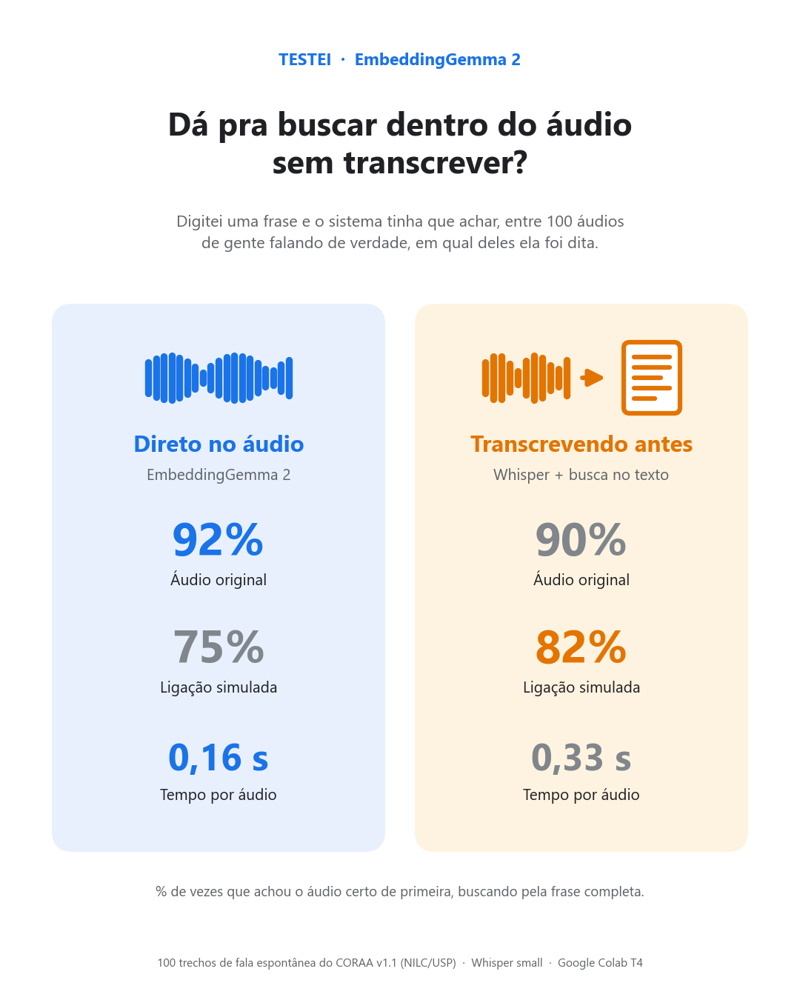
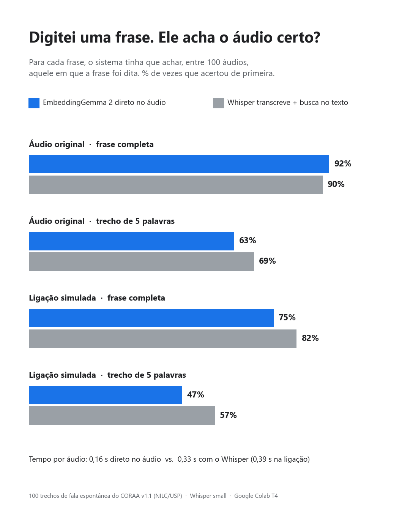
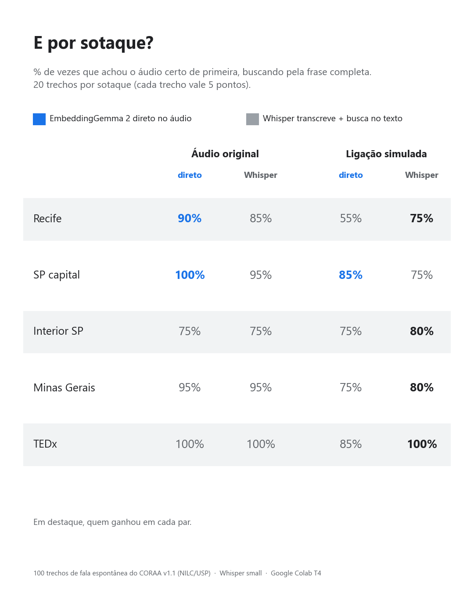

# EmbeddingGemma 2: busca em áudio em português sem transcrever

[](https://colab.research.google.com/github/YasRordrigues/embeddinggemma2-audio-search-ptbr/blob/main/teste_embeddinggemma2.ipynb)

O [EmbeddingGemma 2](https://huggingface.co/google/embeddinggemma-2) coloca texto e áudio no mesmo espaço de embeddings, então em teoria dá para buscar uma frase direto no áudio, sem transcrever antes. Quis ver se isso funciona com áudio difícil em português.



## O teste

Para cada frase, o sistema tem que achar em qual de 100 áudios ela foi dita. Comparei dois jeitos:

- **Direto no áudio:** o EmbeddingGemma 2 gera o embedding do áudio e compara com o da frase.
- **Transcrevendo antes:** o faster-whisper (modelo `small`) transcreve os áudios e o EmbeddingGemma 2 compara a frase com o texto da transcrição.

Os áudios são 100 trechos do conjunto de teste do [CORAA v1.1](https://github.com/nilc-nlp/CORAA) (NILC/USP), fala espontânea de entrevistas e conversas, 20 de cada grupo: Recife (NURC-Recife), São Paulo capital (SP2010), interior de São Paulo (ALIP), Minas Gerais (C-ORAL-BRASIL) e palestras do TEDx. Só entram trechos com 8 palavras ou mais.

Cada áudio também foi testado numa versão de ligação simulada: 8 kHz, só a faixa de voz (300 a 3400 Hz) e ruído branco a 15 dB. A busca foi feita de dois jeitos, com a frase completa e com um trecho aleatório de 5 palavras.

## Resultados

% de vezes que o áudio certo veio em primeiro lugar (R@1). Rodado no Google Colab com GPU T4.

| Áudio | Consulta | Direto no áudio | Transcrevendo antes |
|---|---|---|---|
| Original | Frase completa | **92%** | 90% |
| Original | Trecho de 5 palavras | 63% | **69%** |
| Ligação simulada | Frase completa | 75% | **82%** |
| Ligação simulada | Trecho de 5 palavras | 47% | **57%** |

Tempo por áudio: 0,16 s direto no áudio, contra 0,33 s transcrevendo (0,39 s na ligação simulada).





O script também salva R@5, MRR, o WER do Whisper por sotaque e as transcrições em `resultado_embeddinggemma2.json`.

## Como rodar

No Colab, clique no botão lá em cima, troque o ambiente para GPU T4 e rode as células. Leva uns 10 minutos.

Localmente (precisa de GPU para rodar num tempo razoável):

```bash
pip install -r requirements.txt
python teste_embeddinggemma2.py --per-group 20 --whisper small --seed 42
```

Dá para mudar o número de áudios por sotaque (`--per-group`), o tamanho do Whisper (`--whisper medium`, por exemplo) e a semente do sorteio (`--seed`).

## Arquivos

```
├── teste_embeddinggemma2.ipynb   notebook pronto para o Colab
├── teste_embeddinggemma2.py      o teste completo (amostragem, ligação simulada, busca e métricas)
├── requirements.txt
└── resultados/                   imagens com os resultados
```

## Limitações

São 20 trechos por sotaque, então na tabela por sotaque cada trecho vale 5 pontos percentuais. A ligação é simulada, não é áudio de telefone real. E usei o Whisper `small`; um modelo maior provavelmente transcreveria melhor.

## Dados e licença

O CORAA v1.1 é do NILC/USP, sob licença CC BY-NC-ND 4.0. O script baixa os áudios direto do Hugging Face (`Racoci/CORAA-v1.1`) e nenhum áudio fica neste repositório. O código está sob licença MIT.

## Autora

Feito por [Yasmim Rodrigues](https://www.linkedin.com/in/yasmim-rodrigues-ia/), engenheira de IA, com ajuda do Claude para montar o teste e gerar os áudios de ligação simulada.
